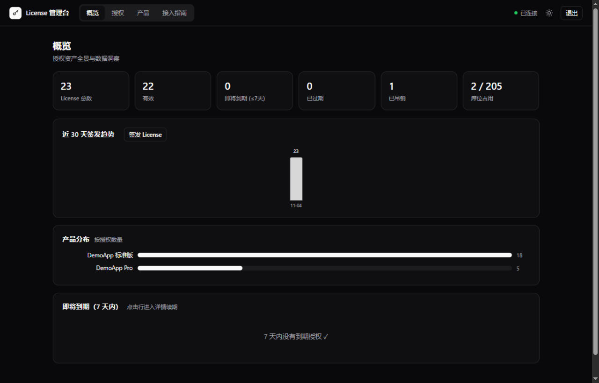
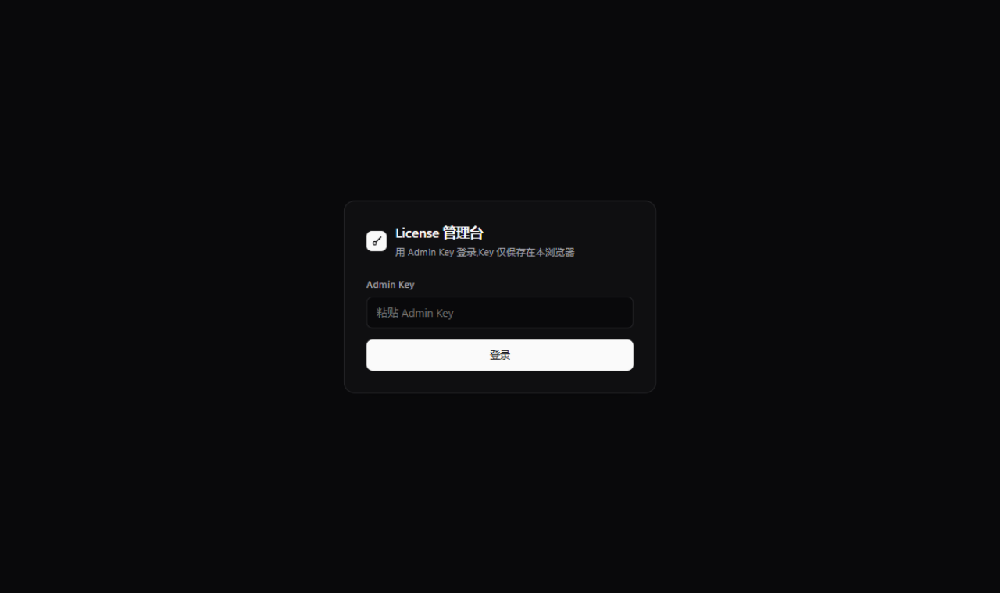
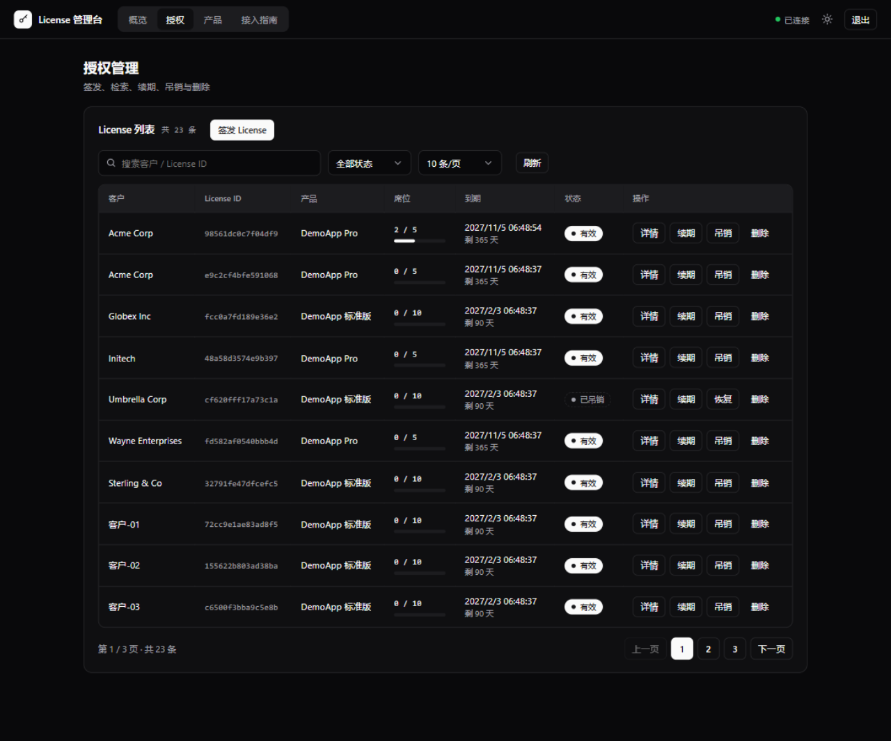
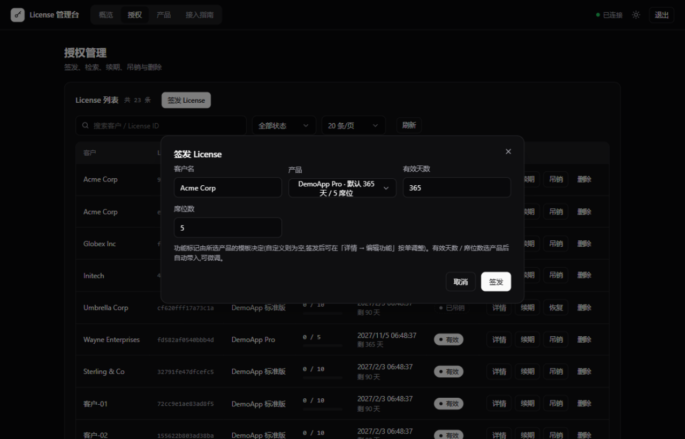
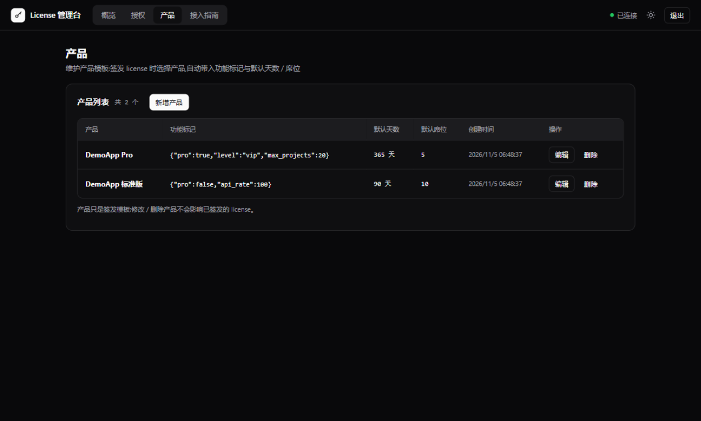
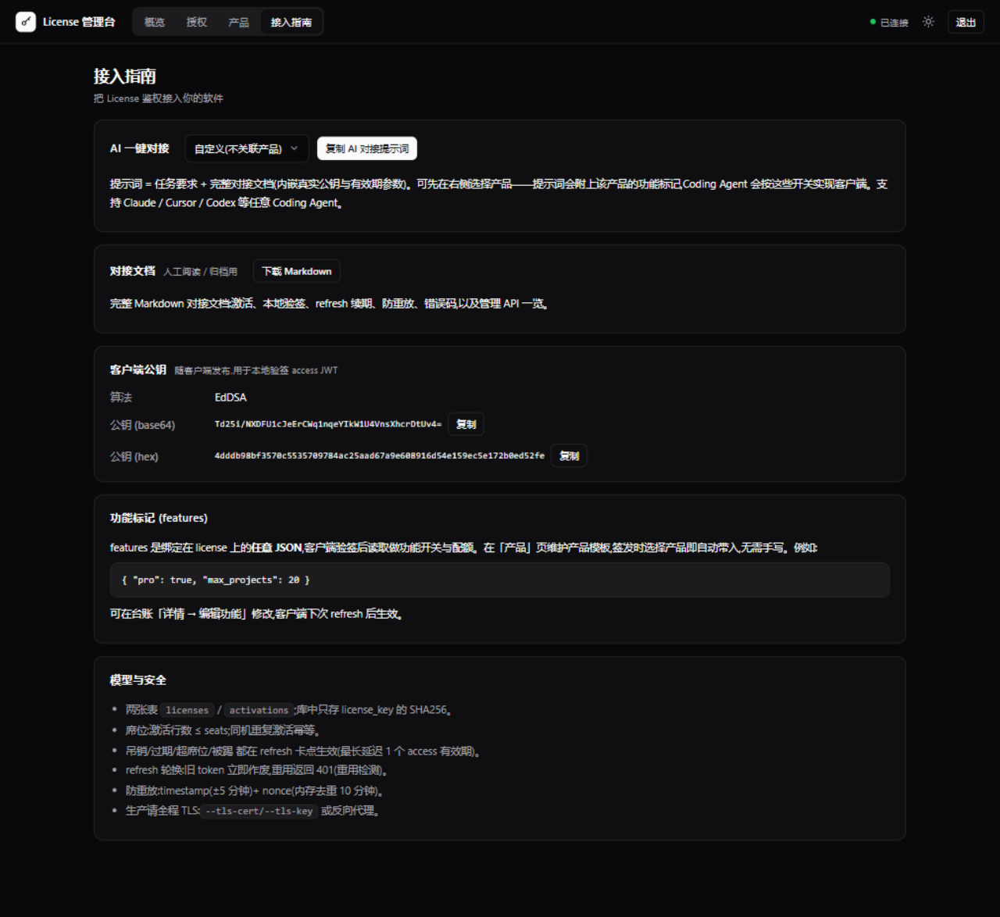

<div align="center">

# license-server

**给你的软件加上"可控分发"能力 —— 轻到一只单二进制,接入只要三步**

Ed25519 签名 access JWT · 设备绑定席位 · refresh 轮换重用检测 · SQLite 单文件 · 零 CGO 零外部依赖

[](https://github.com/COCAINENINJA500/license-server/actions/workflows/ci.yml)
[](https://goreportcard.com/report/github.com/COCAINENINJA500/license-server)

[](LICENSE)

[快速开始](#-快速开始) · [管理台](#-管理台) · [三步接入](#-三步接入ai-一键对接) · [API](#-api) · [安全设计](#-安全设计)



</div>

---

## 为什么是 license-server

给按席位分发的软件加"授权"能力,通常意味着一套账号系统 + 数据库集群 + 管理后台。这个项目把它压缩成:

- **一只二进制 + 一个 SQLite 文件** —— `docker run` 即上生产,断电重启无损
- **客户端只认一把公钥** —— 本地验签、离线宽限,不需要每次联网问服务端
- **管理台内嵌** —— 浏览器打开就有,零 CDN、零安装

## ✨ 特性

| | |
|---|---|
| 🔐 **Ed25519 / EdDSA** | access JWT 服务端签名,客户端公钥本地验签,断网可信 |
| 🪑 **席位制设备绑定** | `machine_hash` 维度绑定,同机重复激活幂等,超席位 403 |
| 🔄 **refresh 轮换 + 重用检测** | 每次续期换发新 refresh;被轮换的旧 token 再次出现立即 `401` |
| 🛡 **防重放** | `timestamp` ±5 分钟 + `nonce` 双代内存去重,复用 `409` |
| 📦 **产品目录** | 维护产品模板(功能标记 / 默认天数 / 席位),签发时选产品自动带入 |
| 🖥 **内嵌管理台** | 单文件 HTML SPA 打进二进制:Dashboard 洞察 / 授权 / 产品 / AI 对接 |
| 🚦 **内置防御** | 每 IP 限流(429)、请求体 1 MiB 上限(413)、全套 HTTP 超时、panic 隔离、优雅停机 |

## 🖥 管理台

| 登录门禁 | Dashboard |
|---|---|
|  |  |
| **授权管理** | **签发 License** |
|  |  |
| **产品目录** | **接入指南** |
|  |  |

## 🚀 快速开始

```bash
docker build -t license-server . && docker run -d -p 8080:8080 -v license-data:/data license-server
```

```bash
# 源码方式
make build
LICENSE_ADMIN_KEY=<强随机串> ./license-server --addr :8080 --db /data/licenses.db \
  --tls-cert /etc/ssl/server.crt --tls-key /etc/ssl/server.key
```

打开 `http://127.0.0.1:8080/admin`,输入启动时打印的 Admin Key 即可进入管理台。

## 🤖 三步接入 + AI 一键对接

1. **建产品**:在「产品」页定义功能标记与默认天数 / 席位
2. **签发 License**:授权页 → 签发,选客户选产品,`license_key` 发给客户
3. **复制 AI 提示词**:接入指南页选产品 → 复制提示词 → 粘贴给 Claude / Cursor / Codex 等 Coding Agent,客户端授权模块直接开工

> [!NOTE]
> 提示词内嵌本实例真实公钥与所选产品的功能标记,Coding Agent 会按规范实现:本地验签、激活、refresh 续期与轮换处理、错误语义、单元测试。不依赖 AI 的话,也可以下载 Markdown 对接文档人工接入。

## 🔎 工作原理

```text
        管理端 (Admin Key)                    服务端                              客户端 (仅公钥)
             │                                 │                                    │
             │  POST /admin/licenses           │                                    │
             │────────────────────────────────▶│ 签发:库中只存 SHA256(key)          │
             │◀──── license_key（仅此一次）─────│                                    │
             │                                 │        license_key 随软件分发 ────▶│
             │                                 │  POST /v1/activate                 │
             │                                 │◀────────────────────────────────────│ 绑定设备
             │                                 │──── access + refresh ─────────────▶│ 本地验签
             │                                 │  POST /v1/refresh（后台自动）       │
             │                                 │◀────────────────────────────────────│ 轮换续期
             │  POST .../revoke                │                                    │
             │────────────────────────────────▶│──── 下次 refresh 403 ─────────────▶│ 提示续费
```

吊销 / 过期 / 超席位 / 被踢全部在 refresh 拒绝——最长延迟 = 1 个 access 有效期(离线宽限上限)。

## 📚 细节文档

<details>
<summary><b>📡 API 一览(点击展开)</b></summary>

管理 API(一律 `Authorization: Bearer <ADMIN_KEY>`):

| 方法 | 路径 | 说明 |
|---|---|---|
| `POST` | `/admin/licenses` | 签发,body `{"customer","product_id"?,"days"?,"seats"?}`——带 `product_id` 时未提供字段自动取产品默认值 |
| `GET` | `/admin/licenses` | 分页列表,query `q` / `status` / `page` / `page_size` / `sort` / `order` |
| `GET` | `/admin/stats` | 汇总统计 |
| `GET` | `/admin/insights` | 数据洞察:近 30 天签发趋势 / 产品分布 / 即将到期 |
| `GET` | `/admin/licenses/{id}` | 查询单个 + 设备列表 |
| `POST` | `/admin/licenses/{id}/revoke` | 吊销(保留台账) |
| `POST` | `/admin/licenses/{id}/restore` | 恢复已吊销 |
| `POST` | `/admin/licenses/{id}/extend` | 续期,body `{"add_days":30}` |
| `POST` | `/admin/licenses/{id}/update` | 修改客户名 / 席位数 |
| `POST` | `/admin/licenses/{id}/features` | 修改功能标记(客户端下次 refresh 生效) |
| `DELETE` | `/admin/licenses/{id}` | 彻底删除(不可恢复) |
| `DELETE` | `/admin/licenses/{id}/machines` | 解绑全部设备 |
| `DELETE` | `/admin/licenses/{id}/machines/{mhash}` | 踢单台设备 |
| `POST` | `/admin/products` | 新增产品(重名 409) |
| `GET` | `/admin/products` | 产品列表 |
| `POST` | `/admin/products/{id}/update` | 修改产品 |
| `DELETE` | `/admin/products/{id}` | 删除产品(已签发 license 不受影响) |

客户端 API:

| 方法 | 路径 | 说明 |
|---|---|---|
| `POST` | `/v1/activate` | `license_key + machine_hash + timestamp + nonce` → access + refresh |
| `POST` | `/v1/refresh` | `refresh_token + timestamp + nonce` → 新 access + 轮换 refresh |
| `GET` | `/v1/status` | Bearer access 查到期信息;或 `?license_key=..&machine_hash=..` 查摘要 |
| `GET` | `/v1/pubkey` | 取 Ed25519 公钥 |
| `GET` | `/healthz` | 健康检查(含版本号) |

错误码:`400` 参数 / 时间窗 / nonce 格式 · `401` key 或 token 无效 / refresh 重用 · `403` 已吊销 / 过期 / 超席位 / 被踢 · `409` nonce 重放 · `413` 请求体超限 · `429` 触发限流

</details>

<details>
<summary><b>🧪 curl 全流程示例(点击展开)</b></summary>

```bash
# 1. 签发(选产品,自动带入功能标记与默认天数/席位)
curl -s https://lic.example.com/admin/licenses \
  -H "Authorization: Bearer $ADMIN" -H "Content-Type: application/json" \
  -d '{"customer":"Acme","product_id":"<产品ID>"}'

# 2. 客户端激活(machine_hash = 设备稳定标识的 SHA256 hex)
TS=$(date +%s); NONCE=$(openssl rand -hex 12)
curl -s https://lic.example.com/v1/activate -H "Content-Type: application/json" -d "{
  \"license_key\":\"LIC-...\",\"machine_hash\":\"$MACHINE\",
  \"timestamp\":$TS,\"nonce\":\"$NONCE\"}"

# 3. 续期(每次轮换,覆盖保存新 refresh;重用旧 token 返回 401)
curl -s https://lic.example.com/v1/refresh -H "Content-Type: application/json" -d "{
  \"refresh_token\":\"$REFRESH\",\"timestamp\":$TS,\"nonce\":\"$NONCE\"}"

# 4. 查询 / 吊销 / 续费 / 踢设备
curl -s https://lic.example.com/v1/status -H "Authorization: Bearer $ACCESS"
curl -s -X POST https://lic.example.com/admin/licenses/<id>/revoke -H "Authorization: Bearer $ADMIN"
curl -s -X POST https://lic.example.com/admin/licenses/<id>/extend -H "Authorization: Bearer $ADMIN" \
  -H "Content-Type: application/json" -d '{"add_days":30}'
curl -s -X DELETE https://lic.example.com/admin/licenses/<id>/machines/$MACHINE -H "Authorization: Bearer $ADMIN"
```

</details>

<details>
<summary><b>🐍 客户端集成伪代码(点击展开)</b></summary>

```python
def machine_hash():
    raw = platform.node() + "-" + disk_serial() + "-" + cpu_id()
    return hashlib.sha256(raw.encode()).hexdigest()

def get_valid_access():
    toks = load(STORE)
    if toks is None:
        return call_activate()                  # 首次运行
    claims = jwt.decode(toks["access_token"], PUBKEY_B64, algorithms=["EdDSA"])
    if claims["exp"] - time.time() < 6 * 3600:  # 剩余 < 6h 后台续期
        try:
            call_refresh(toks["refresh_token"])  # 轮换:覆盖保存新 refresh
        except LicenseInvalid:
            raise                                # 401/403 = 被吊销/过期/超席位/被踢
        except Exception:
            pass                                 # 网络异常:凭旧 access 撑到 exp
    return toks["access_token"], claims["features"]
```

完整可运行版本在服务端管理台「接入指南」一键下载,或直接复制 AI 提示词让 Coding Agent 生成。

</details>

<details>
<summary><b>🗃 数据模型(点击展开)</b></summary>

```sql
licenses(id, key_hash UNIQUE, customer, seats, expires_at, features, status,
         created_at, product_id, product_name)
-- key_hash = SHA256 hex(license_key),库里永远没有明文 key
activations(license_id, machine_hash, first_seen, last_seen, current_refresh_jti,
            PRIMARY KEY(license_id, machine_hash))
products(id, name UNIQUE, features, default_days, default_seats, created_at)
-- 产品是签发侧模板:签发时把产品的 features / 默认值复制进 license,此后互不影响
```

</details>

## 🛡 安全设计

- **全程 TLS**:直连 `--tls-cert/--tls-key` 或反向代理;敏感查询用 Bearer 模式避免 key 进访问日志
- **最小信任面**:客户端只内置公钥;Admin Key 常数时间比较;服务端只存 key 的 SHA256
- **输入面收敛**:全部查询参数化、排序字段白名单、body 1 MiB、每 IP 限流、防重放
- **密钥隔离**:签名私钥文件 0600 且被 .gitignore 排除;泄露需轮换并重新发布客户端公钥
- 本系统不做防共享(同 key 同 machine_hash 无法识别共用),强绑定场景结合硬件指纹 + 小席位 + 短 access-ttl

## 🧪 测试

```bash
go test -race ./...    # 或 make test
```

16 组用例:签发→激活→JWT 验签、超席位、同机幂等、吊销 / 过期后 refresh 403、**轮换重用 401**、nonce 重放 409、限流 429、请求体超限 413、产品 CRUD 与按产品签发、管理鉴权、密钥文件、nonce 代际清理等。

## 📄 License

[Apache-2.0](LICENSE) © 2026 n0way10se
